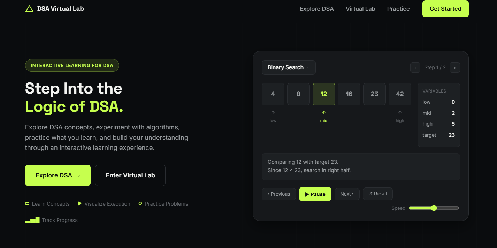
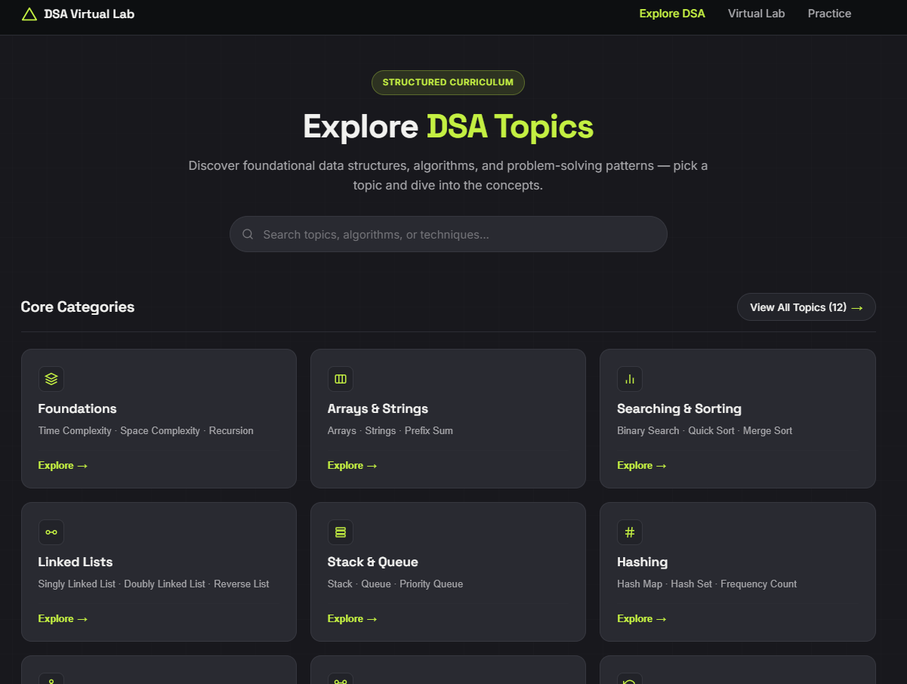
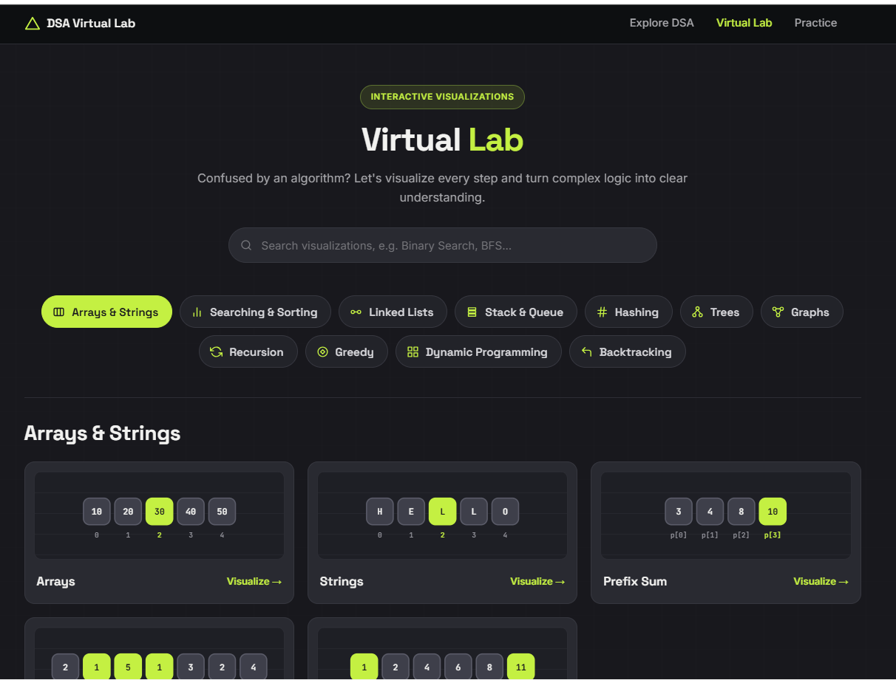
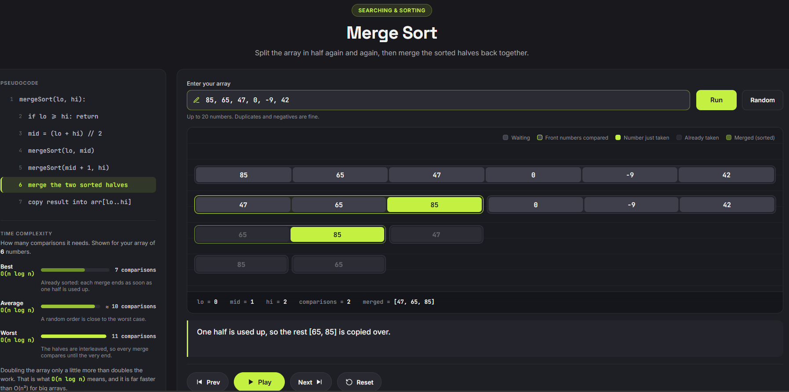
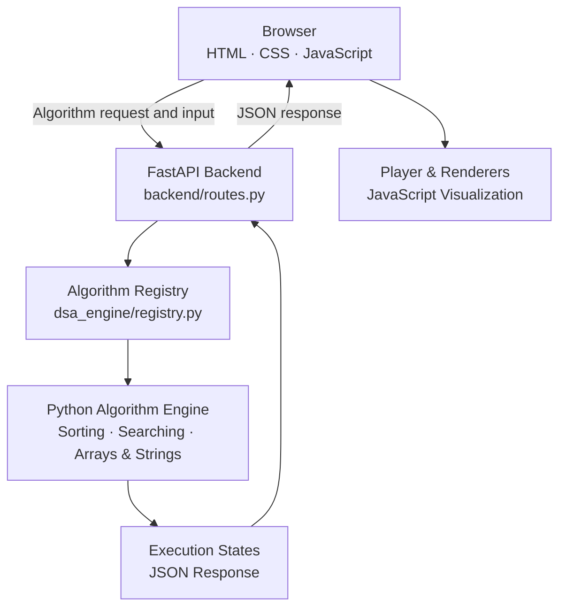

#  DSA Virtual Lab

**Don't just read algorithms. Watch them think.**

An interactive learning platform where Data Structures & Algorithms run **step by step, right in your browser**. Pick an algorithm, enter your own input, and watch every comparison, swap, and decision as it happens.

<p>
  
  
  
  
  
  
</p>

<hr>

<h2>Why This Project?</h2>

Most students learn algorithms by reading code or looking at static diagrams. This explains *what* an algorithm does, but not always *how* it works internally. The difficult part is understanding how data changes from one step to the next.

DSA Virtual Lab makes this process visible. Each algorithm executes step by step, with a plain-English explanation, the current pseudocode line, live variables, and a complexity breakdown.

<hr>

<h2>Features</h2>

- **Step-by-step playback:** Play, Pause, Previous, Next, and Reset.
- **Speed control:** Five playback speeds, from Very Slow to Turbo.
- **Step slider:** Drag to jump to any execution step.
- **Keyboard shortcuts:** `Space` to play/pause and `←` / `→` to navigate.
- **Custom input:** Enter up to 20 numbers or generate random input.
- **Live pseudocode:** Highlights the line currently being executed.
- **Live variables:** Displays variables such as `i`, `j`, and `min`, along with comparisons and swaps.
- **Complexity panel:** Shows best, average, and worst-case complexity, with comparison counts for the input.
- **Step explanations:** Provides plain-English explanations and a colour legend.
- **Algorithm-specific visualizations:** Uses bubbles, tiles, cards, and merge trees depending on the algorithm.
- **Explore DSA:** Provides concept pages across 12 categories using JSON-based content.

<hr>

<h2>Project Preview</h2>

<table>
  <tr>
    <td>
      <strong>Home Page</strong><br><br>
      
    </td>
  </tr>
  <tr>
    <td>
      <strong>Explore DSA</strong><br><br>
      
    </td>
  </tr>
  <tr>
    <td>
      <strong>Virtual Lab</strong><br><br>
      
    </td>
  </tr>
  <tr>
    <td>
      <strong>Merge Sort Visualizer</strong><br><br>
      
    </td>
  </tr>
</table>

<hr>

<h2>How It Works</h2>

Each Python algorithm records snapshots of its execution after important operations. FastAPI sends these snapshots to the browser in JSON format, and JavaScript uses them to display and replay the algorithm step by step.



**Core Components**

| Component | Responsibility |
|---|---|
| **Algorithm Engine (Python)** | Executes algorithms and records execution states. |
| **Backend (FastAPI)** | Receives requests, invokes algorithms, and returns states as JSON. |
| **Player (JavaScript)** | Manages the current step, playback, speed, and navigation. |
| **Renderers (JavaScript)** | Displays each execution step using an appropriate visual representation. |

This separation makes the system modular. New algorithms can be integrated by adding an engine implementation, registering it, and creating or reusing a suitable renderer.

<hr>

<h2>Tech Stack</h2>

<p>
  
</p>

| Layer | Technology |
|---|---|
| Algorithm Engine | Python |
| API | FastAPI + Uvicorn |
| Frontend | HTML, CSS, Vanilla JavaScript |
| Content | JSON files |
| Development Tools | Git, GitHub, VS Code |

<hr>

<h2>Project Structure</h2>

```text
DSA-Virtual-Lab/
│
├── backend/
│   ├── main.py
│   └── routes.py
│
├── dsa_engine/
│   ├── arrays_strings/
│   ├── searching/
│   ├── sorting/
│   ├── common.py
│   └── registry.py
│
├── frontend/
│   ├── css/
│   ├── data/
│   ├── js/
│   │   ├── renderers/
│   │   ├── visualizer/
│   │   ├── explore.js
│   │   ├── virtual-lab.js
│   │   └── script.js
│   │
│   ├── index.html
│   ├── explore.html
│   ├── virtual-lab.html
│   ├── visualizer.html
│   └── practice.html
│
├── docs/
│   ├── logo.svg
│   ├── home.png
│   ├── explore.png
│   ├── virtual-lab.png
│   └── mergeSort.png
│
├── requirements.txt
└── README.md
```

<hr>

<h2>Getting Started</h2>

**Requirements**

- Python 3.10 or newer
- Git
- Visual Studio Code
- Live Server extension for VS Code

**1. Clone the repository**

```bash
git clone https://github.com/Chandni-R53/DSA-Virtual-Lab.git
cd DSA-Virtual-Lab
```

**2. Create and activate a virtual environment (Windows)**

```bash
python -m venv .venv
.venv\Scripts\activate
```

**3. Install dependencies**

```bash
pip install -r requirements.txt
```

**4. Start the backend**

```bash
uvicorn backend.main:app --reload
```

**5. Launch the frontend**

Open `frontend/index.html` in VS Code, right-click, and select **Open with Live Server**.

> Keep both services running: Uvicorn serves the backend API, while Live Server serves the frontend pages.

<hr>

<h2>What I Learned</h2>

- Designing a modular system that separates data, logic, and presentation.
- Converting algorithm execution into state snapshots that can be replayed forwards and backwards.
- Building interactive interfaces using HTML, CSS, and vanilla JavaScript.
- Developing REST APIs using FastAPI and connecting a separate frontend.
- Working with DOM updates, Fetch API, timers, and JavaScript state.
- Designing algorithm-specific visualizations and improving their readability.

<hr>

<h2>About the Author</h2>

**Chandni Rajawat**  
B.Tech – Information Technology (IoT)  
Madhav Institute of Technology & Science, Gwalior

<p>
  <a href="https://www.linkedin.com/in/chandni-rajawat/">
    
  </a>
  <a href="mailto:rajawatchandni53@gmail.com">
    
  </a>
</p>