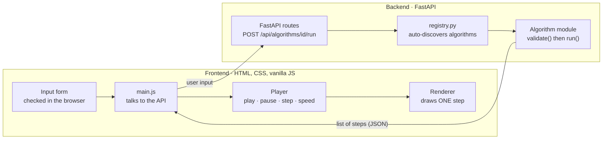

<div align="center">


<br>


**Type your own input. Press play. Watch an algorithm think, one step at a time.**

[Demo](#-demo) · [Visualizers](#-the-visualizers) · [How it works](#-how-it-works) · [Run it](#-getting-started) · [Roadmap](#-roadmap)

</div>

---

## 📖 What is this?

**DSA Virtual Lab** is a web app that makes data structures and algorithms *visible*. Most learning material shows a fixed diagram of an algorithm running on one fixed example. Here, **you choose the input** (or press *Random*), and the app replays exactly what the algorithm does with it: every comparison, swap and pointer move, with the matching line of pseudocode lit up and a plain-English sentence explaining what just happened.

The algorithms themselves run in **Python** (FastAPI). The browser only draws what Python tells it, so what you see is what the real algorithm did, not a hand-made animation.

> 💡 **The idea in one line:** *record the algorithm as a list of steps in Python, then replay those steps like a video in the browser.*

<br>

## 🎬 Demo

<div align="center">
  
  <br>
  <sub>Quick Sort on <code>64, 25, 12, 22, 11, 90, 45, 7</code>: pivot level, partition zones, live variables and a plain-English explanation of every step.</sub>
</div>

<br>

## ✨ Features

| | |
|---|---|
| 🎞️ **Step-by-step playback** | Play, pause, step forward and back, jump anywhere with the slider, and pick one of five speeds. |
| ⌨️ **Keyboard friendly** | `Space` play / pause, `←` `→` step back and forward. |
| 🧑‍💻 **Your own input** | Type any valid input or press **Random**. Every algorithm accepts duplicates, negatives and single items. |
| 🛡️ **Friendly error handling** | Wrong input never breaks the page. Each mistake gets a clear message ("`x` is not a whole number…"), checked in the browser *and* again on the server. |
| 📜 **Live pseudocode** | The line being executed is highlighted. Pseudocode is written in plain language, not tied to one programming language. |
| 🔢 **Live variables** | A strip under the animation shows the values that matter (`i`, `j`, `pivot`, `comparisons`, `swaps`…). |
| 💬 **Plain-English narration** | Every step explains *why* the algorithm did what it did. |
| 📊 **Complexity, for your input** | The panel does not just print `O(n²)`. It shows best / average / worst case *for the array you typed*. |
| 🎨 **A different look per algorithm** | Bubbles, tiles, cards, a merge tree, partition pillars, memory cells, film strips… no copy-pasted bar charts. |
| 📱 **Responsive** | Works from a wide desktop down to a phone, and respects "reduce motion" settings. |

<br>

## 🧪 The Visualizers

Every algorithm below has its **own renderer**, designed to show the *idea* behind it.

<table>
  <tr>
    <td width="50%" align="center">
      <br>
      <b>Linear Search</b><br>
      <sub>Check items one by one. Checked cells fade, the match lights up.<br><code>O(n)</code></sub>
    </td>
    <td width="50%" align="center">
      <br>
      <b>Binary Search</b><br>
      <sub><code>L</code> <code>M</code> <code>R</code> pointers cut the search space in half each step.<br><code>O(log n)</code></sub>
    </td>
  </tr>
  <tr>
    <td align="center">
      <br>
      <b>Selection Sort</b><br>
      <sub>A scanner beam hunts for the minimum, then the tile drops onto a "sorted shelf".<br><code>O(n²)</code></sub>
    </td>
    <td align="center">
      <br>
      <b>Insertion Sort</b><br>
      <sub>Playing cards: the key card is lifted out and slid into place.<br><code>O(n²)</code>, best case <code>O(n)</code></sub>
    </td>
  </tr>
  <tr>
    <td align="center">
      <br>
      <b>Bubble Sort</b><br>
      <sub>Bubbles sized by value float to the surface line as they settle.<br><code>O(n²)</code>, best case <code>O(n)</code></sub>
    </td>
    <td align="center">
      <br>
      <b>Merge Sort</b><br>
      <sub>A recursion tree: split down, then merge back up, depth-first, exactly like the real recursion.<br><code>O(n log n)</code></sub>
    </td>
  </tr>
  <tr>
    <td align="center">
      <br>
      <b>Quick Sort</b><br>
      <sub>Pillars, a dashed pivot level and colour-coded zones show the partition.<br><code>O(n log n)</code> average, <code>O(n²)</code> worst</sub>
    </td>
    <td align="center">
      <br>
      <b>Arrays</b><br>
      <sub>Real memory cells with addresses. Insert and delete show the shifting.<br>access <code>O(1)</code>, insert / delete <code>O(n)</code></sub>
    </td>
  </tr>
  <tr>
    <td align="center">
      <br>
      <b>Strings</b><br>
      <sub>Letter keys: reverse, palindrome check, count a character, find a word.<br><code>O(n)</code>, find <code>O(n × m)</code></sub>
    </td>
    <td align="center">
      <br>
      <b>Sliding Window</b><br>
      <sub>A glass lens slides along a film strip, on numbers <i>or</i> text.<br><code>O(n)</code></sub>
    </td>
  </tr>
</table>

<details>
<summary><b>🔎 More than a single run: what each page can do</b></summary>

<br>

| Visualizer | What you can try |
|---|---|
| **Linear Search** | Any list and target, including "target not found". |
| **Binary Search** | Needs a sorted list; unsorted input is rejected with a clear message. |
| **Selection / Insertion / Bubble / Merge / Quick Sort** | Up to 20 numbers with duplicates and negatives, already-sorted and reversed input, a single number. |
| **Arrays** | `Access`, `Update`, `Insert`, `Append`, `Delete` at any valid index, with out-of-range and full-array handling. |
| **Strings** | `Reverse`, `Palindrome check` (ignores spaces, symbols and capitals), `Count a character`, `Find a word`. |
| **Sliding Window** | *Best window of size k*, *Longest with no repeats*, *Smallest window with sum ≥ target*. Works on numbers and on text. |

</details>

<br>

### 📱 The Virtual Lab page and mobile view

<table>
  <tr>
    <td width="68%" align="center">
      <br>
      <sub><b>Virtual Lab</b>: pick a topic, pick a visualizer. Each card has a live preview.</sub>
    </td>
    <td width="32%" align="center">
      <br>
      <sub><b>On a phone</b>: the layout reflows, and wide animations scroll inside their own panel.</sub>
    </td>
  </tr>
</table>

<br>

## ⚙️ How it works

The project is split into a **frontend that only draws** and a **Python engine that only thinks**.



### 1. Record, then replay

When you press **Run**, Python executes the real algorithm and writes down a *snapshot* after every meaningful moment. The browser receives the whole list and the **Player** walks through it. That is why you can go *backwards*, jump to any step, and change speed instantly: nothing is recomputed.

<details>
<summary><b>What one step looks like</b> (real output from <code>quick_sort.py</code>)</summary>

```json
{
  "data": [3, 8, 7, 1, 5, 9, 2, 6],
  "range": [0, 7],
  "pivot": 7,
  "i": 0,
  "comparing": [1, 7],
  "line": 4,
  "message": "Is 3 ≤ pivot 6? Yes, so it belongs on the small side. Swap it with arr[0].",
  "vars": [
    { "k": "range =", "v": "[0, 7]", "hl": false },
    { "k": "pivot =", "v": 6,        "hl": true  },
    { "k": "i =",     "v": 0,        "hl": false }
  ]
}
```

`line` lights up the pseudocode, `message` is the narration, `vars` fills the live-variables strip, and everything else tells the renderer what to draw.

</details>

### 2. One renderer per algorithm

A **renderer** is a small JavaScript file that knows how to draw *one step* and nothing else:

```js
window.RENDERERS.partition = {
  render(canvas, step) { /* draw this step */ }
};
```

Because renderers are separate from algorithms, each algorithm gets a visual that fits its idea (a recursion tree for Merge Sort, memory cells for Arrays) instead of the same bar chart every time. The page loads a renderer on demand, by name, only when it is needed.

### 3. Algorithms register themselves

The backend has no hard-coded list of algorithms. `registry.py` scans the `dsa_engine/` folder and registers every module that provides `META`, `validate`, `run` and `random_input`.

<br>

## 🛠️ Engineering highlights

- **Clean separation of concerns.** Algorithm logic (Python), transport (FastAPI), playback (`player.js`) and drawing (renderers) never mix. Any one can change without touching the others.
- **Plugin-style extensibility.** Adding an algorithm means adding files. No route, registry or page code changes.
- **Defensive input handling.** Input is validated **twice**: instantly in the browser, and again on the server (which never trusts the client). Edge cases handled include empty input, hex / exponent / decimal look-alikes (`0x10`, `1e3`, `1.5`), out-of-range values, oversized input, unsorted input for Binary Search, emoji and accented characters, and invalid indexes.
- **Honest complexity.** Best / average / worst counts are computed for the user's actual input size.
- **Accessibility and polish.** Keyboard shortcuts, `aria` labels, focus-safe controls, `prefers-reduced-motion` support, and layouts checked down to phone width.
- **Deterministic and testable.** An algorithm is a plain Python function from input to a list of steps, so it can be tested without a browser.

<br>

## 🧰 Tech stack

| Layer | Technology |
|---|---|
| **Frontend** | HTML5, CSS3 (custom properties, flexbox, grid), vanilla JavaScript (ES6), no framework or build step |
| **Backend** | Python 3.10+, [FastAPI](https://fastapi.tiangolo.com/), Uvicorn |
| **Data flow** | JSON over a small REST API, auto-documented by FastAPI at `/docs` |
| **Design** | Custom dark theme (graphite `#18181D` with lime `#C4F042`), Space Grotesk, Inter and JetBrains Mono |

<br>

## 🚀 Getting started

### Prerequisites

- **Python 3.10+**
- A modern browser
- *(optional)* VS Code with the **Live Server** extension

### 1. Clone and install

```bash
git clone https://github.com/<your-username>/<your-repo>.git
cd "DSA Virtual Lab"

python -m venv .venv

# Windows
.venv\Scripts\activate
# macOS / Linux
source .venv/bin/activate

pip install -r requirements.txt
```

### 2. Start the backend

Run this from the project folder (the one containing `backend/` and `dsa_engine/`):

```bash
uvicorn backend.main:app --reload
```

The API is now at `http://localhost:8000`, with interactive docs at **`http://localhost:8000/docs`**.

### 3. Open the frontend

Open `frontend/index.html` with **Live Server** (or any static server), or simply double-click the file.

```bash
# alternative: a tiny static server
cd frontend
python -m http.server 5500
# then visit http://localhost:5500
```

> If the visualizer says it cannot reach the server, make sure step 2 is running. The API address is set in **one line** at the top of `frontend/js/visualizer/main.js` (`API_BASE`).

<details>
<summary><b>🔌 API reference</b></summary>

<br>

| Method | Endpoint | Purpose |
|---|---|---|
| `GET` | `/api/algorithms` | List every registered algorithm |
| `GET` | `/api/algorithms/{id}` | Title, description, pseudocode, legend, input fields, defaults |
| `POST` | `/api/algorithms/{id}/run` | Validate the input, run the algorithm, return `{ steps, complexity }` (`400` with a friendly message on bad input) |
| `GET` | `/api/algorithms/{id}/random` | A random valid input for the **Random** button |

```bash
curl -X POST http://localhost:8000/api/algorithms/quick-sort/run \
     -H "Content-Type: application/json" \
     -d '{"array": [8, 3, 7, 1, 5]}'
```

</details>

<br>

## 🗂️ Project structure

<details open>
<summary><b>Click to expand</b></summary>

```
DSA Virtual Lab/
├── backend/                     # the web layer: knows nothing about algorithms
│   └── main.py                  #   FastAPI app, CORS and the 4 endpoints shared by every algorithm
│
├── dsa_engine/                  # the brain: pure Python, no web code
│   ├── common.py                #   shared input checks and helpers
│   ├── registry.py              #   auto-discovers algorithms
│   ├── searching/               #   linear_search.py, binary_search.py
│   ├── sorting/                 #   selection, insertion, bubble, merge, quick sort
│   └── arrays_strings/          #   arrays.py, strings.py, sliding_window.py
│
├── frontend/                    # the face: HTML, CSS and vanilla JS
│   ├── index.html               #   landing page
│   ├── *.html                   #   explorer, Virtual Lab catalogue, and the one visualizer page
│   ├── css/
│   ├── data/
│   └── js/
│       ├── script.js, explore.js, virtual-lab.js
│       ├── visualizer/
│       │   ├── main.js          #   builds the page from the algorithm's description
│       │   └── player.js        #   play / pause / step / speed (algorithm-agnostic)
│       └── renderers/           #   ONE drawing style per algorithm
│           ├── cells.js  tiles.js  cards.js  bubbles.js  mergetree.js
│           └── partition.js  memory.js  letters.js  slider.js
│
├── requirements.txt
└── README.md
```

</details>

<br>

## ➕ Adding a new algorithm

Because of the plugin design, a new algorithm is **two files**:

**1. The brain**: `dsa_engine/<category>/my_algorithm.py`

```python
META = {
    "id": "my-algorithm",              # matches ?sub=my-algorithm in the URL
    "title": "My Algorithm",
    "renderer": "my-style",            # which drawing file to load
    "pseudocode": [{"t": "step one", "indent": 0}],
    "inputs": [...], "defaults": {...}, "legend": [...],
}

def validate(data): ...                # raise ValueError("friendly message") on bad input
def random_input(): ...                # for the Random button
def run(values):                       # return the list of steps
    return [{"data": [...], "line": 0, "message": "...", "vars": [], "result": None}, ...]
```

**2. The look** *(only if it needs a new visual)*: `frontend/js/renderers/my-style.js`

```js
window.RENDERERS['my-style'] = { render(canvas, step) { /* draw */ } };
```

Restart the server and the new visualizer is live: no route, registry or page changes.

<br>

## 🗺️ Roadmap

- [x] Player with play / pause / step / speed / scrub / keyboard shortcuts
- [x] Searching: Linear Search, Binary Search
- [x] Sorting: Selection, Insertion, Bubble, Merge, Quick Sort
- [x] Arrays, Strings and Sliding Window (numbers *and* text)
- [x] Responsive layout and reduced-motion support
- [ ] Two Pointers and Prefix Sum
- [ ] Heap Sort and a **Compare mode** that races two algorithms on the same input
- [ ] Linked Lists, Stack & Queue, Hashing
- [ ] Trees, Graphs, Recursion
- [ ] Greedy, Dynamic Programming, Backtracking
- [ ] Practice page with problems and progress tracking
- [ ] User accounts (planned stack: SQLAlchemy, MySQL, JWT)

<br>

## 👤 About the author

Built by **[Chandni Rajawat]**, a student passionate about making hard computer-science ideas easy to *see*.

[](https://github.com/Chandni-R53/DSA-Virtual-Lab.git)
[](https://linkedin.com/in/chandni-rajawat/)
[](mailto:rajawatchandni53@gmail.com)

<br>

<div align="center">

If this project helped you understand an algorithm, a ⭐ on the repo is always appreciated.

</div>