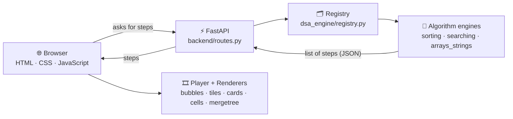

<div align="center">

# 🔺 DSA Virtual Lab

### Don't just read algorithms. Watch them think.

An interactive learning platform where Data Structures & Algorithms run **step by step, right in your browser**.
Pick an algorithm, type your own input, and see every comparison, swap and decision as it happens.

<p>
  
  
  
  
  
  
</p>

---

## Why this project?

Most students learn algorithms by reading code or looking at a few static diagrams. That shows *what* an algorithm does, but not *why* it works. The hard part is the middle: how the data changes from one step to the next.

DSA Virtual Lab makes that middle part visible. Every algorithm is executed step by step, and each step is shown on screen with a plain-English explanation, the current pseudocode line, live variables, and a complexity breakdown.

---

## Features

- **Step-by-step playback**: Play, Pause, Previous, Next and Reset
- **Speed control**: five speeds, from Very slow to Turbo
- **Step slider**: drag to jump to any step
- **Keyboard shortcuts**: `Space` to play/pause, `←` / `→` to move between steps
- **Your own input**: type up to 20 numbers, or press Random
- **Live pseudocode**: the line being executed is highlighted
- **Live variables**: `i`, `j`, `min`, comparisons and swaps update at every step
- **Complexity panel**: best, average and worst case, with comparison counts for *your* array
- **Plain-English explanation** for every step, plus a colour legend
- **A different visual style per algorithm** (bubbles, tiles, cards, merge tree) so each one looks like how it works
- 📚 **Explore DSA**: concept pages across 12 categories, loaded from JSON (not hard-coded in HTML)

---

## 🖼️ Screenshots

<table>
  <tr>
    <td align="center"><b>Home</b><br></td>
    <td align="center"><b>Explore DSA</b><br></td>
  </tr>
  <tr>
    <td align="center"><b>Virtual Lab topics</b><br></td>
  </tr>
  <tr>
    <td align="center"><b>Merge Sort visualizer</b><br></td>
  </tr>
</table>

---

## How it works

Every algorithm is written in Python as a function that records a **snapshot (a "step")** after each important operation. The backend sends those steps to the browser as JSON, and the frontend plays them back.



**Three parts, kept separate on purpose:**

| Part | Job |
|------|-----|
| **Engine** (Python) | Runs the algorithm and records every step |
| **Player** (JavaScript) | Holds the current step number. Next, Previous, Play and speed just change that number |
| **Renderer** (JavaScript) | Draws one step on screen, in the style that suits that algorithm |

Because of this split, adding a new algorithm means writing one engine file, one renderer (or reusing an existing one), and registering it. The page, controls and panels stay the same.

---

## Tech stack

<p>
  
</p>

| Layer | Technology |
|-------|-----------|
| Algorithm engine | Python |
| API | FastAPI + Uvicorn |
| Frontend | HTML, CSS, vanilla JavaScript (no framework) |
| Content | JSON files for the Explore DSA pages |
| Tools | Git, GitHub, VS Code |

---

## Project structure

```
DSA Virtual Lab/
├── backend/
│   ├── main.py             # FastAPI app entry point
│   └── routes.py           # API routes that serve algorithm steps
├── dsa_engine/
│   ├── arrays_strings/     # array & string algorithms
│   ├── searching/          # searching algorithms
│   ├── sorting/            # sorting algorithms
│   ├── common.py           # shared helpers
│   └── registry.py         # maps algorithm names to engine functions
├── frontend/
│   ├── css/
│   ├── data/               # JSON content for Explore DSA
│   ├── js/
│   │   ├── renderers/      # one visual style per algorithm
│   │   ├── visualizer/     # visualizer page logic
│   │   ├── explore.js
│   │   ├── virtual-lab.js
│   │   └── script.js
│   ├── index.html
│   ├── explore.html
│   ├── virtual-lab.html
│   ├── visualizer.html
│   └── practice.html
├── requirements.txt
└── README.md
```

---

## Getting started

**Requirements:** Python 3.10 or newer, Git, and VS Code with the *Live Server* extension.

```bash
# 1. Clone the repository
git clone https://github.com/YOUR-USERNAME/dsa-virtual-lab.git
cd dsa-virtual-lab

# 2. Create and activate a virtual environment (Windows)
python -m venv .venv
.venv\Scripts\activate

# 3. Install dependencies
pip install -r requirements.txt

# 4. Start the backend
uvicorn backend.main:app --reload
```

Then open `frontend/index.html` in VS Code, right-click it, and choose **Open with Live Server**.

> Keep both running: the backend (Uvicorn) serves the algorithm steps, and Live Server serves the pages.

---

## What I learned

- Designing a system where **data, logic and display are separate**, so new content doesn't mean rewriting the page
- Turning an algorithm into a **list of state snapshots** that a UI can replay forwards and backwards
- Building a full frontend with **plain HTML, CSS and JavaScript**: DOM updates, `fetch`, timers and state
- Building a **REST API with FastAPI** and connecting it to a separate frontend
- Designing a consistent UI theme and making each visualization readable for beginners

---

## Author

**Chandni Rajawat**
B.Tech Information Technology (IoT), Madhav Institute of Technology & Science, Gwalior

[](https://github.com/Chandni-R53/DSA-Virtual-Lab.git)
[](https://www.linkedin.com/in/chandni-rajawat/)
[](mailto:rajawatchandni53@gmail.com)

---

<div align="center">

⭐ If you found this project useful, consider giving it a star.

</div>